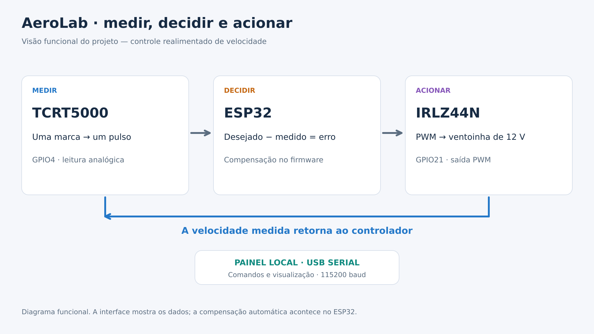

# AeroLab — controle e medição de velocidade com ESP32

Projeto de Henrique: ventoinha de **12 V e dois fios**, leitura óptica com **TCRT5000 avulso**, acionamento por **IRLZ44N** e painel local por USB serial.

O sistema oferece controle manual por percentual de PWM e controle realimentado por RPM desejado. O firmware atual conta **uma marca por volta**, mesmo com nove pás.



## Começar

1. Abra na Arduino IDE o sketch completo [`firmware/Ventoinha_Percentual_RPM/Ventoinha_Percentual_RPM.ino`](firmware/Ventoinha_Percentual_RPM/Ventoinha_Percentual_RPM.ino), se precisar programar a placa.
2. O sketch preservado inicia em **100% de PWM**. A abertura da porta serial pode reiniciar a placa.
3. Feche o Monitor/Plotter Serial da IDE e abra [`web/dist/Painel_Ventoinha.html`](web/dist/Painel_Ventoinha.html) no Chrome ou Edge de computador.
4. Conecte o ESP32 por USB, clique em **Conectar ESP32** e selecione a porta. Serial: **115200 baud**.
5. Selecione **Percentual** ou **RPM alvo** e aplique o valor. **Parar ventoinha** envia zero.

Se o navegador bloquear a conexão no arquivo local, execute `web/Iniciar_Painel_Windows.bat` ou `python3 web/server_local.py`. O servidor usa somente localhost. O HTML não depende de internet nem de CDN.

## Pastas

| Pasta/arquivo | Conteúdo |
|---|---|
| `firmware/` | Sketch atual, preservado sem alterações |
| `web/` | Painel independente, fontes, build e testes |
| `mecanica/v1_original/` | Seis STLs, OpenSCAD, prévia e documentação da V1 |
| `assets/visuais/` | Artes novas em SVG editável e PNG 1920×1080 para o vídeo |
| `assets/fotos_sensor/` | Três fotos originais do sensor |
| `assets/esquemas_historicos/` | Cinco imagens das etapas anteriores |
| `docs/` | Eletrônica, código, protocolo, validação e GitHub |
| `video/` | Narração, roteiro, storyboard, lista de gravações e configuração |
| `CLAUDE.md` | Contexto e instruções para o agente editor |
| `tools/` | Geração dos visuais, trechos e verificação do manifesto |
| `historico/` | Firmware anterior de leitura por espaços; não é o firmware principal |

## Para editar o vídeo com Claude Code

Abra esta pasta no agente e envie:

> Leia CLAUDE.md e video/PROMPT_CLAUDE.md. Faça o inventário dos materiais e proponha a edição usando video/storyboard.csv e video/roteiro.md. Confira as pendências em video/materiais.json. Vamos produzir um vídeo de até seis minutos.

Já existem artes e roteiro. Ainda são necessárias a narração e a demonstração real gravadas por Henrique. O endereço do GitHub não foi informado: `video/config.json` mantém esse campo vazio.

## Convenções atuais

| Variável | Cor no painel e nos visuais |
|---|---|
| RPM desejado / setpoint | Laranja, linha contínua mais grossa |
| RPM medido | Azul |
| PWM | Roxo pontilhado; eixo direito |

Sensor no **GPIO4**; PWM no **GPIO21**. ADC de 12 bits; limiares **1300/2350**; PWM de **1000 Hz**, 8 bits; **1 pulso por volta**. Ganho **0.005**, margem **±60 RPM**, correção limitada a **5 pontos percentuais por segundo**.

## Conferência e desenvolvimento

Node.js é necessário só para regenerar o painel e executar os testes; o HTML pronto já está incluído.

```sh
node web/build.cjs
node --test web/tests/*.test.cjs
python3 tools/atualizar_trechos.py
python3 tools/verificar_manifesto.py
```

Após edições intencionais, regenere o manifesto com `python3 tools/verificar_manifesto.py --gerar`. Ele verifica integridade de arquivos, não funcionamento da eletrônica.

## O que foi preservado e o que requer atenção

- O firmware e os fontes do painel foram recuperados dos arquivos do projeto e preservados.
- Os esquemas antigos incluem GPIO25 e até um módulo digital, que não correspondem ao código atual. Use `assets/visuais/02_esquema_gpio21.png` e leia `docs/hardware.md`; a nova arte atualiza a referência anterior, não documenta uma inspeção da bancada.
- A V1 mecânica foi concebida para ler espaços diante de um fundo branco. Ela está incluída como arquivo original; não se deve concluir que é um CAD atualizado da peça atualmente em uso. O firmware principal usa uma marca por volta.
- Henrique relatou funcionamento correto. Este pacote não inclui uma nova medição física nem um ensaio de precisão. Consulte `docs/validacao.md`.
- O limite de 50.000 RPM aceito pelo comando é um limite do software, não uma capacidade demonstrada da ventoinha.

## GitHub

O pacote está preparado para iniciar um repositório, mas não foi publicado. Veja [`docs/github.md`](docs/github.md). Nenhuma licença foi presumida; escolha uma antes de conceder permissões públicas de reutilização. O pacote não contém `.git`, credenciais, dependências instaladas nem arquivos de outros projetos.
