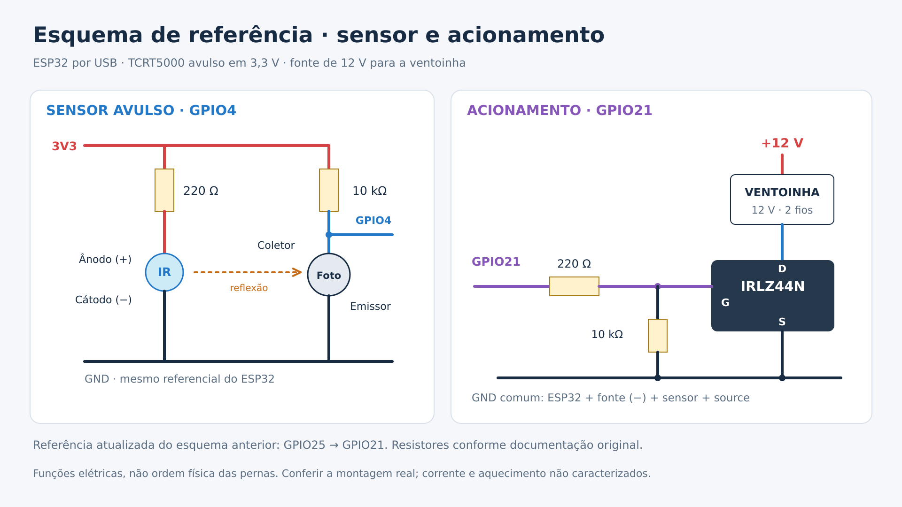

# Montagem e referência elétrica

## Componentes identificados

| Item | Especificação/conhecimento disponível |
|---|---|
| Microcontrolador | ESP32; modelo exato da placa e versão do core Arduino não registrados |
| Ventoinha | 12 V, 2 fios, nove pás; dimensões informadas 58×58×15 mm |
| Fonte | 12 V; corrente nominal não informada |
| Acionamento | IRLZ44N |
| Sensor | TCRT5000 avulso; corpo informado aproximadamente 10×5×5 mm |
| Resistores dos esquemas | 220 Ω no LED IR; 10 kΩ no coletor; 220 Ω no gate e 10 kΩ gate–GND |
| Mecânica | Suporte impresso; arquivos V1 disponíveis |

Os valores dos resistores são os documentados nos esquemas anteriores, não medições atuais da peça. O 2N2222 foi citado no início, mas o acionamento usado nesta versão é com IRLZ44N.

## Ligações de referência

> Confirmado por Henrique em 21/10/2026: o esquema GPIO21 abaixo corresponde à montagem real.

- ESP32 por USB; ventoinha pelo +12 V da fonte.
- GPIO21 → resistor de gate de 220 Ω → gate do MOSFET.
- Resistor de 10 kΩ entre gate e GND; source no GND comum.
- Drain no negativo da ventoinha; positivo da ventoinha no +12 V.
- Negativo da fonte, GND do ESP32 e source unidos.
- LED IR: 3V3 → 220 Ω → ânodo; cátodo no GND.
- Fototransistor: emissor no GND, coletor no GPIO4; pull-up de 10 kΩ entre coletor e 3V3.

As pernas do sensor devem seguir a identificação feita no componente; não se deduz polaridade apenas pela cor das janelas. A arte indica funções elétricas, não a ordem física das quatro pernas. O sensor e GPIOs usam a referência de 3,3 V, não 12 V.

O diagrama novo transcreve a topologia do esquema completo anterior e corrige GPIO25 para GPIO21. Não substitui confirmação da montagem real, corrente da fonte/ventoinha ou adequação térmica. O esquema original já observava que a condução do IRLZ44N a 3,3 V não é garantida; isso não foi caracterizado neste pacote.

## Leitura óptica atual

Uma marca refletiva por volta. Contagem abaixo de 1300, rearmada acima de 2350. Os limiares são da montagem do projeto; outra geometria pode exigir recalibração. Não usar nove pulsos por volta apenas porque existem nove pás.

## Histórico visual

| Imagem em `assets/esquemas_historicos/` | Uso correto |
|---|---|
| `Montagem_Completa_ESP32_TCRT5000_IRLZ44N.png` | Base da referência elétrica; texto antigo usa GPIO25 |
| `Ligacao_ESP32_Ventoinha_IRLZ44N.png` | Proposta inicial com módulo digital/GPIO27 e PWM25; não é a montagem final |
| `Etapa2_TCRT5000_Ventoinha_RPM.png` | Etapa de medição sem controle pelo MOSFET |
| `TCRT5000_ESP32_Contagem_GPIO4.png` | Teste de contagem por aproximação de papel |
| `Teste_TCRT5000_Avulso.png` | Teste inicial com multímetro |

## Mecânica recuperada

> Confirmado por Henrique em 21/10/2026: a peça impressa é a versão **integral** (`00_conjunto_integral_FIXO.stl`); a marca fica em uma pá e o sensor lê pela frente.

`mecanica/v1_original/` preserva o projeto para fundo branco atrás das pás, incluindo a documentação original e a distância nominal de 19,1 mm. Não descreva essa geometria como a configuração óptica comprovada da versão atual. Henrique informou que imprimiu a peça e depois usou uma única marca; não há CAD revisado ou foto atual da montagem entre os arquivos recuperados. Use uma gravação real para mostrar como ficou.
